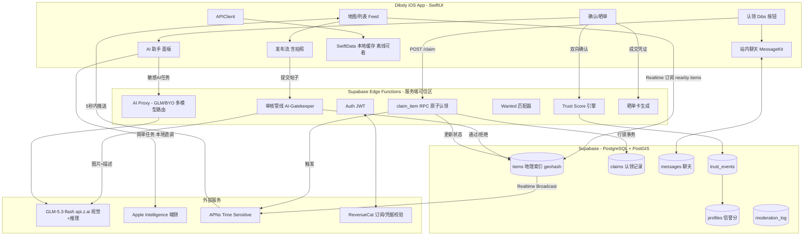
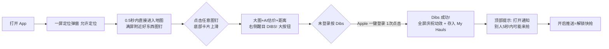
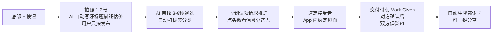
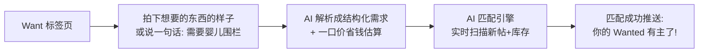
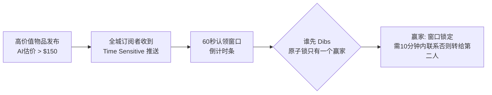
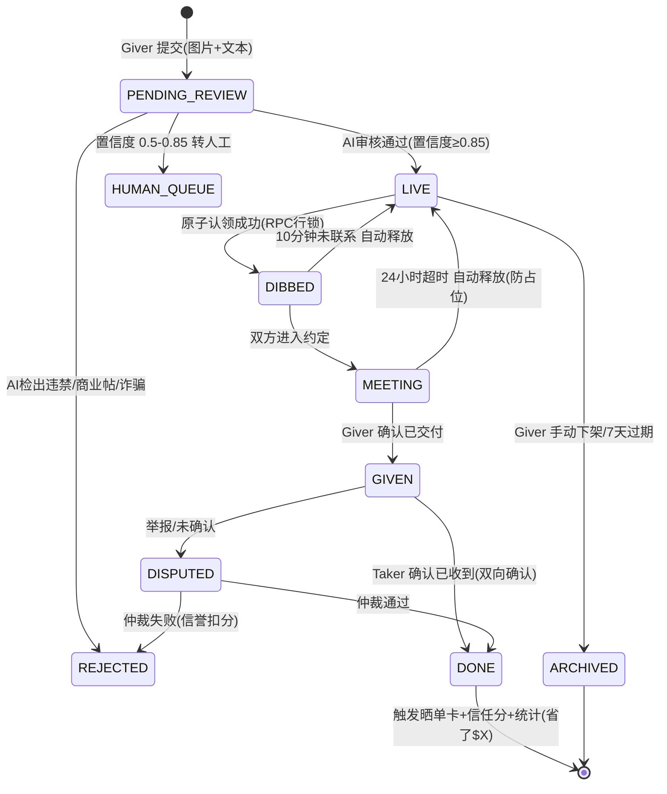
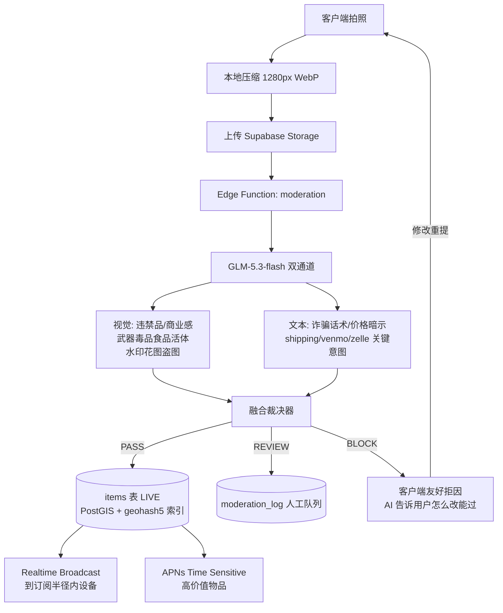
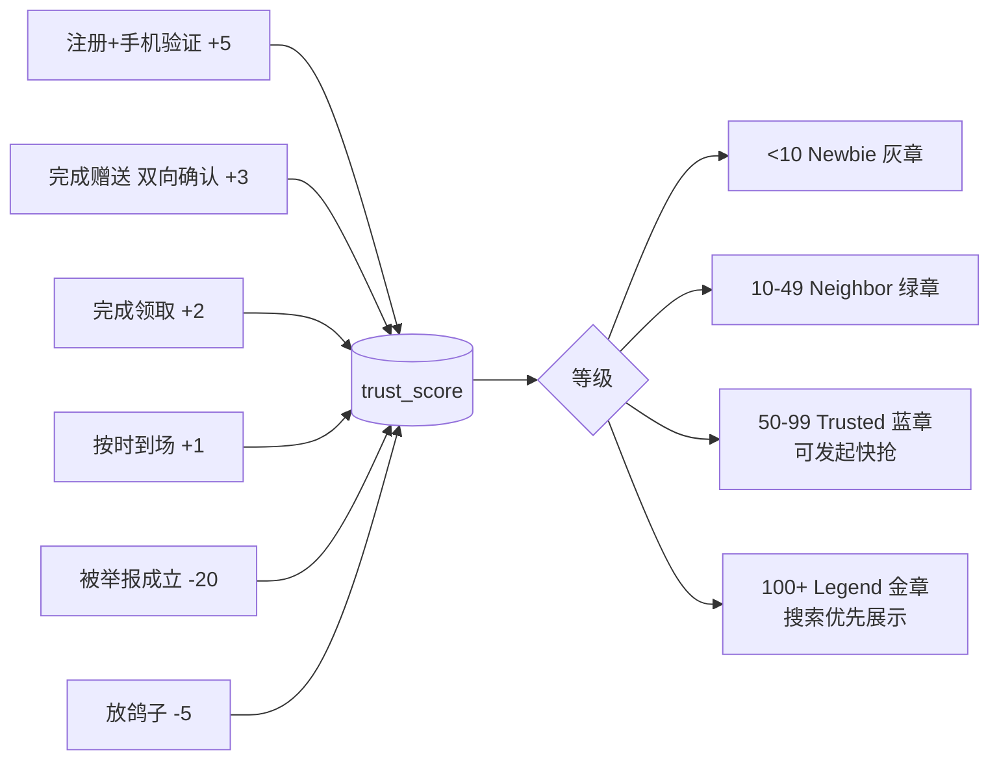

# TR-20261013-Dibsly 免费物品雷达-操作指南

> **文档目标**：任何 LLM / 开发者拿到本文档后，可以完整复刻出一款**碾压 Snag（$30K MRR 免费物品地图 App）**的极具竞争优势的 iOS 应用。
> **文档日期**：2026-10-13 ｜ **目标市场**：🇺🇸 美国 ｜ **平台**：iOS（SwiftUI 原生）
> **原型来源**：#5 Snag —— 附近免费物品地图（4 个月 $30,793 MRR，103K 认证用户，9,000 付费转化 ≈ 9%，$80K+ 累计收入，3,300+ 商店评分）

---

# ⭐ 第一部分：APP 命名与副标题（最关键）

## 1.1 最终命名

| 项目 | 内容 |
|------|------|
| **APP 名字** | **Dibsly** |
| **副标题（Subtitle，≤30字符）** | `Call dibs on free stuff` |
| **推广口号（营销用）** | "Someone's trash. Your treasure. Call Dibsly." |
| **备选名（如商标受阻）** | **Zilcho**（副标题：`Free stuff near you`）/ **Swooply**（副标题：`Grab free stuff first`） |
| **项目中文名称** | 免费物品雷达 / Dibsly |

> ⚠️ 命名禁令已遵守：不使用 Snag / Freebie Alerts / Swoop / Freebox / Freezy / Buy Nothing / Olio / Freecycle / trashnothing 等任何已存在竞品名；名字中**不含冒号**；"Dibsly" 经全网检索确认无 App Store 同名应用、无美国本土大品牌冲突。

## 1.2 命名深度分析（五个维度）

### ① ASO 搜索优化
- 核心心智词 **"dibs"**：美国人对"抢先认领"的国民级口语（*call dibs* = 我先占到/我先要），月搜索量稳定且**零头部 App 占据**——是 ASO 蓝海词。
- 副标题埋入品类词 **"free stuff"**：美国月均搜索量 10 万+（Snag、Freebie Alerts、Swoop 全部在抢这个词），配合 App 名形成 "Dibsly + free stuff" 双词覆盖。
- 关键词栏建议：`free stuff, curb alert, free furniture, giveaway, free items, near me, free stuff near me, claim, dibs, marketplace`。
- "Dibsly" 是自造词 → **商标注册通过率高**（对比通用词 Freezy/Freebox 极难保护），且 ASO 中独占搜索结果页。

### ② 品牌记忆度（最关键）
- 双音节 + "-ly" 后缀，2 秒记住；发音 /ˈdɪbzli/ 无歧义。
- **自带动词化能力**：用户会说 "I Dibsly'd this couch"（我抢到了这张沙发）——产品名即用户动作，天然形成口头传播。
- 与美国文化梗 **"call dibs"** 强绑定：看到好东西喊 dibs 是美国孩子到成人的集体记忆，情感零学习成本。
- 备选 **Zilcho**（zero + -o，"一分钱不用花！"）自带惊讶语气，适合 TikTok 口播梗（"I got this for... ZILCHO!"）。

### ③ 功能描述性
- "Call dibs on free stuff" 副标题 5 个词讲清全部价值：**有免费的东西 → 你可以抢 → 就在附近**。用户无需看截图就懂。

### ④ 情感共鸣
- "抢到 = 赢了" 的多巴胺；免费 = 聪明人的胜利（美国家庭对 deal 文化极度自豪，r/Freebies、r/frugal 数百万订阅）。
- Dibsly 的胜利感比 Snag（抓取）更强：Snag 是"捡到"，Dibsly 是**"我抢先占到了"**——社交炫耀感更强，利于晒单传播。

### ⑤ 国际化适配
- 纯英文拼读，无生僻字母组合；德/法/西/葡语用户均可直读。
- "dibs" 在英语圈（美/加/澳/英）通用；非英语市场可作为"异域品牌词"处理（如 Olio、Vinted 的成功路径）。

---

# 第二部分：竞品深度分析与痛点研究（pain-point-hunter 输出）

## 2.1 竞争格局总览

| 竞品 | 规模验证 | 商业模式 | 致命缺陷 |
|---|---|---|---|
| **Snag**（对标主目标） | $30K MRR / 4个月，103K 用户 | 免费+周/月/年/一次性订阅 | 纯聚合器（数据来自 FB/Craigslist/Nextdoor 抓取），无信任体系、无站内聊天闭环、依赖外部平台 |
| Freebie Alerts（235K 评分） | 类目免费榜头名 | 免费+广告/订阅 | Unstar 差评聚类：**诈骗和误导性帖子（高发）**、联系信息缺失、过度推送、依赖 FB/Nextdoor、距离计算不准、崩溃与扣费问题 |
| Swoop - Free Stuff Marketplace | 2026 年新入场 | 免费+IAP | 纯克隆 Snag，无差异化，网络效应未成 |
| Freebox: Free Stuff to Flip | 2026 年新入场 | 免费+IAP | 定位"翻货套利"，社区感为零 |
| Buy Nothing 官方 App 3.0 | 全球运动数千万参与者 | 完全免费 | **官方 App 连环翻车**：密码重置 bug、搜索/冻结/滚动 bug、3.0 上线即大规模投诉（官方连发多轮修复公告） |
| Freecycle / Freegle / trashnothing | 老牌（20年+） | 免费/捐赠 | 网页时代 UX、邮件式回复、**无站内聊天、无审核、无社区保护**（trashnothing 官方横评原话） |
| Olio | 食物浪费赛道 | 免费+商业 | 以食品为主+英联邦市场为主，美国覆盖浅 |
| FB Marketplace / Craigslist free | 流量最大 | 平台引流 | 诈骗重灾区、无验证、体验噪音大 |

## 2.2 用户原话（痛点证据，保留原文）

> *"High scam awareness needed; No in-app chat, email replies only; No moderation or community protection."*
> —— trashnothing 官方 2026 竞品横评（翻译：需要高度防骗意识；没有 App 内聊天只能邮件回复；没有审核和社区保护）

> *"app crashes, missing features, billing issues, and update regressions."*
> —— Freebie Alerts Google Play 差评聚类（翻译：崩溃、缺功能、扣费问题、更新回退）

> *"Users frequently complain about scams and misleading listings, difficulty contacting sellers due to missing contact info, and excessive reliance on external platforms like Facebook or Nextdoor."*
> —— Freebie Alerts 负面评论分析（翻译：诈骗与误导帖高发、联系不上发布者、严重依赖外部平台）

> Buy Nothing 官方公告（2026-01）自曝：*"We're aware of a bug specifically affecting password resets… squashed the bug causing intermittent delays… scrolling through posts and comments smoothly"*
> ——（翻译：官方 App 连密码重置、卡顿冻结都要连发公告修复——社区型产品的工程底子普遍拉胯）

## 2.3 痛点评级与量化（pain-point-hunter 五维模型）

| # | 痛点 | 具体性 | 独特性 | 可实现性 | 付费性 | 市场规模 | 综合 |
|---|---|---|---|---|---|---|---|
| P1 | **诈骗/商业帖混入免费区，无人审核** | 9.5 | 9 | 8 | 9 | 10 | **91 💎** |
| P2 | **放鸽子（no-show）/ 占位不取，无信誉惩罚** | 9 | 9.5 | 8.5 | 8.5 | 9 | **89 💎** |
| P3 | **好货秒光但推送延迟（赢家=先知道）** | 9.5 | 8 | 9 | 9.5 | 9 | **90 💎** |
| P4 | 跨平台割裂（FB群/Craigslist/Nextdoor 各自为战） | 8.5 | 8.5 | 6(合规风险) | 8 | 9 | 80 🥇 |
| P5 | 无站内聊天/联系不上人 | 9 | 8 | 9 | 8 | 8.5 | 85 🥇 |
| P6 | 线下见面安全焦虑（去陌生人家里） | 9 | 7.5 | 8 | 7.5 | 9 | 82 🥇 |
| P7 | Wanted（求物）反向发布体验差 | 8.5 | 8 | 9 | 7 | 8 | 81 🥇 |
| P8 | 无社交传播钩子（抢到没法炫耀） | 8 | 8.5 | 9.5 | 6.5 | 9 | 83 🥇 |

> **结论**：Snag 赚到了"免费物品"刚需的钱，但整条赛道**没有一家解决了"信任与安全"**。这就是我们的碾压位：**把"诈骗重灾区"变成"信誉社区"**。付费点自然挂在 P1/P2/P3 的解法上。

## 2.4 客户需求清单（按优先级）

1. **真·实时**：好东西发布的 5 秒内推到手机（Snag 的推送是分钟级轮询）
2. **防诈骗**：AI 前置审核 + 商业帖识别 + 举报降权
3. **防鸽子**：认领→确认→双方互评闭环，鸽子扣信誉
4. **安全见面**：内置 Safe Exchange Zone 推荐 + 安全指引
5. **一键晒单**：抢到东西自动生成"免费省了 $X"炫耀卡
6. **求物反向发布**：贴一张照片描述想要什么，AI 自动匹配
7. **AI 估价**："这张免费沙发值 $400" —— 让省钱的爽感可见

---

# 第三部分：GitHub 可二次开发项目调研（gh CLI 实测检索）

## 3.1 推荐二开/参考项目清单

| 项目 | Stars | 语言 | 用途 | 二开方式 |
|---|---|---|---|---|
| **MessageKit/MessageKit** | 6,267 | Swift | iOS 聊天 UI 全家桶（气泡/输入栏/附件） | 二开：换皮肤适配 Dibsly 卡片风，接 Supabase Realtime 作消息源 |
| **ekazaev/ChatLayout** | 1,057 | Swift | 高性能 UICollectionView 聊天布局 | 备选：消息量大时替换 MessageKit 内核 |
| **Couchers-org/couchers** | 572 | Python | 开源沙发客平台（非营利社区） | **参考其信任/信誉与社区治理模型**（身份验证、担保评价、举报仲裁流程） |
| **karrot-dev/karrot**（foodsharing） | — | Django+Vue | 开源食物分享/物品赠送社区（地图+小组+信任） | 参考：赠送确认(至今已避免多少浪费的统计闭环)与地图信息架构 |
| **supabase-community/supabase-swift** | — | Swift | Supabase 官方 SDK（Realtime/Auth/PostgREST） | 直接依赖：登录+数据库+实时订阅+Edge Functions |
| **kean/Nuke** | — | Swift | 高性能图片加载/缓存/降采样 | 直接依赖：物品图瀑布流性能保障 |
| **freecycleScraper（MyNameIsMikeGreen）** | 6 | Python | 多页 Freecycle 新帖增量识别 | 参考：聚合类抓取器的增量去重思路（注意合规，见 7.6） |
| **opencycle/opencycle** | 4 | PHP | 开源 Freecycle 克隆 | 仅作数据模型参考 |

> 检索命令记录（可复跑）：`gh search repos "freecycle"` / `gh search repos "buy nothing"` / `gh search repos "MessageKit" --sort stars` / `gh repo view supabase-community/supabase-swift` 等。Search API 有速率限制，间隔 20s 重试。

## 3.2 技术选型结论（二开整合方案）

```
前端：SwiftUI (iOS 26) + MapKit + Nuke + MessageKit(聊天)
后端：Supabase（PostgreSQL+PostGIS / Auth / Realtime / Edge Functions / Storage）
     —— Snag 同款后端，但我们的 Edge Functions 里加 AI 审核层
AI：Apple Intelligence（端侧，免费）+ GLM-5.3-flash（云端推理/视觉）+ BYO 多模型
支付：StoreKit 2 + RevenueCat（订阅管理）+ 消耗型 AI Credits IAP
推送：APNs（Time Sensitive 关键提醒）
```

---

# 第四部分：产品定义——7 个碾压点

| # | 碾压点 | Snag 现状 | Dibsly 做法 |
|---|---|---|---|
| 1 | **Dibs 30 秒快抢** | 分钟级轮询推送 | Realtime 广播 + APNs Time Sensitive（iOS 关键提醒直达锁屏）+ 高价值物品 60 秒认领窗口 |
| 2 | **AI 门卫审核** | 无（商业帖混入） | 每帖过 GLM-5.3-flash 视觉+文本审核：识别商业转卖/违禁品/诈骗话术，置信度<阈值进人工队列 |
| 3 | **Trust Score 信誉分** | 无 | 双向确认+1，鸽子-5，诈骗-20 封禁；等级徽章 Newbie→Neighbor→Trusted→Legend |
| 4 | **确认闭环（防鸽子）** | 无 | Giver 确认"已交付" + Taker 确认"已收到" 才算成交；24h 未确认自动释放回池 |
| 5 | **晒单传播飞轮** | 无 | 成交即生成"Saved $X"分享卡（含物品照片+金额），一键发 TikTok/IG Story——Snag 自己靠 UGC 打广告，我们把每个用户变成 UGC |
| 6 | **AI 估价爽感** | 无 | 拍照/认领即估价："You just saved $340"——把抽象的免费变成具体的钱 |
| 7 | **安全见面** | 无 | 内置 police-station Safe Exchange Zone 地图层 + 见面安全清单 |

---

# 第五部分：实现流程图（系统架构）



---

# 第六部分：用户使用流程图（极端重要——爽感设计）

> 设计宗旨：**3 步内触达核心价值**（打开→看到附近好东西→按下 Dibs）。全 App 无"必填资料"墙，先爽后补。

## 6.1 新用户首次启动（0 学习成本）



爽感细节：
- 登录用 **Sign in with Apple 单击完成**，绝无邮箱/密码/资料表单。
- 首屏即价值（地图+图钉），无 Onboarding 问卷、无付费墙首屏（付费墙在 Dibs 成功后 24h 以"快抢模式"形式出现，转化率更高）。
- Dibs 按钮按下 = 老虎机式滚动动效 + "🎉 YOU GOT DIBS!"——把认领做成胜利时刻。

## 6.2 赠送方流程（Giver——3 步送出）



爽感细节：**AI 帮写一切**——拍照后 GLM 自动生成标题/描述/分类/估价，Giver 唯一动作就是按"Post"。省事即爽。

## 6.3 求物方流程（Wanted——反向发布）



## 6.4 快抢时刻（付费核心场景）



---

# 第七部分：软件数据流图（极端重要——防错设计）

> 原则：**每一个状态转移都有超时兜底；每一个写操作都幂等；每一张图片都过审；位置只存粗粒度。**

## 7.1 物品生命周期状态机



## 7.2 发布审核数据流（防诈骗核心管线）



**防错细节**：
- 每次审核写 `moderation_log`（可追溯、可申诉、可回放）。
- GLM 调用失败 → **降级策略**：先放行到 `HUMAN_QUEUE`（绝不因为 AI 挂了导致用户发不出帖，也绝不无审核直接 LIVE）。
- 同一图片重复检测（感知哈希 pHash）防止"马甲商业号"批量铺帖。

## 7.3 认领防双抢数据流（正确性核心）

```mermaid
flowchart TB
    A[Taker 按 DIBS] --> B[POST /rpc/claim_item\n带 item_id + 幂等 client_uuid]
    B --> C{Postgres 事务}
    C -- SELECT ... FOR UPDATE\n行锁 items 行 --> D{status == LIVE ?}
    D -- 是 --> E[UPDATE status=DIBBED\ndibbed_by=taker\ndibs_expires_at=now()+10min]
    E --> F[INSERT claims 记录\n返回 WIN]
    F --> G[客户端庆祝动效]
    D -- 否 --> H[返回 ALREADY_TAKEN\n客户端立刻推荐相似物品]
    C -- 网络重试 --> I[client_uuid 唯一约束\n重试返回首次结果 幂等]
    E --> J[Realtime: 通知 Giver\n+ 通知其他围观者 已被抢走]
```

**为什么不会出错**：数据库行锁保证并发下只有一个赢家（比客户端判断可靠一个数量级）；幂等键保证弱网重试不产生幽灵认领；10 分钟未联系自动释放保证物品不因单个用户卡死。

## 7.4 位置隐私数据流

```
客户端定位 → 端侧裁剪至 geohash5(约 4.9km 网格) + 城市名
→ 仅上传粗粒度网格，不存精确经纬度
→ 见面地点由聊天中双方自定（App 内置 Safe Zone 推荐层）
→ 地图展示时帖子位置加 ±300m 随机模糊偏移
```

## 7.5 信任分数据流



---

# 第八部分：核心技术实现代码示例与编写规则

## 8.1 数据库 Schema（Supabase / PostgreSQL，可直接执行）

```sql
-- ============ profiles ============
create table public.profiles (
  id uuid primary key references auth.users on delete cascade,
  handle text unique not null,
  avatar_url text,
  trust_score int not null default 5,
  phone_verified boolean not null default false,
  created_at timestamptz not null default now()
);

-- ============ items（物品） ============
create table public.items (
  id uuid primary key default gen_random_uuid(),
  giver_id uuid not null references public.profiles(id),
  title text not null check (char_length(title) between 3 and 80),
  description text,
  category text not null,             -- furniture/electronics/baby/...
  est_value_cents int,                -- AI 估价（美分）
  photo_paths text[] not null check (array_length(photo_paths,1) between 1 and 3),
  status text not null default 'PENDING_REVIEW'
    check (status in ('PENDING_REVIEW','HUMAN_QUEUE','LIVE','DIBBED',
                      'MEETING','GIVEN','DONE','ARCHIVED','REJECTED')),
  geohash5 text not null,             -- 粗粒度位置网格（隐私安全）
  city text not null,
  dibs_by uuid references public.profiles(id),
  dibs_expires_at timestamptz,
  client_uuid uuid unique,            -- 幂等键
  created_at timestamptz not null default now()
);
create index idx_items_geo on public.items (geohash5, status, created_at desc);
create index idx_items_status_time on public.items (status, created_at desc);

-- ============ claims（认领） ============
create table public.claims (
  id uuid primary key default gen_random_uuid(),
  item_id uuid not null references public.items(id),
  taker_id uuid not null references public.profiles(id),
  result text not null check (result in ('WIN','LOST','EXPIRED')),
  client_uuid uuid unique not null,   -- 幂等：弱网重试不重复
  created_at timestamptz not null default now()
);

-- ============ moderation_log（审核留痕） ============
create table public.moderation_log (
  id uuid primary key default gen_random_uuid(),
  item_id uuid not null,
  verdict text not null,              -- PASS / REVIEW / BLOCK
  reasons jsonb,                      -- GLM 返回的结构化原因
  model text not null,
  created_at timestamptz not null default now()
);

-- ============ trust_events ============
create table public.trust_events (
  id uuid primary key default gen_random_uuid(),
  user_id uuid not null references public.profiles(id),
  delta int not null,
  reason text not null,               -- 'GIVE_DONE' / 'NO_SHOW' / 'SCAM' ...
  created_at timestamptz not null default now()
);

-- ============ RLS（行级安全） ============
alter table public.items enable row level security;
create policy "public read live items" on public.items
  for select using (status in ('LIVE','DIBBED','DONE'));
create policy "giver manages own items" on public.items
  for all using (auth.uid() = giver_id);
-- 客户端永远无权直接改 status：状态流转只能走 claim_item RPC / Edge Functions
```

## 8.2 原子认领 RPC（防双抢的核心，保证"不易出错"）

```sql
create or replace function public.claim_item(
  p_item_id uuid,
  p_client_uuid uuid
) returns jsonb
language plpgsql
security definer
as $$
declare
  v_item public.items;
  v_me uuid := auth.uid();
begin
  -- 幂等：同一 client_uuid 重试返回首次结果
  if exists (select 1 from public.claims where client_uuid = p_client_uuid) then
    return jsonb_build_object('status','IDEMPOTENT',
      'result',(select result from public.claims where client_uuid = p_client_uuid limit 1));
  end if;

  -- 行锁：并发认领在此排队
  select * into v_item from public.items
   where id = p_item_id and status = 'LIVE'
   for update;

  if not found then
    insert into public.claims(item_id, taker_id, result, client_uuid)
    values (p_item_id, v_me, 'LOST', p_client_uuid);
    return jsonb_build_object('status','ALREADY_TAKEN');
  end if;

  if v_item.giver_id = v_me then
    return jsonb_build_object('status','ERROR','reason','own_item');
  end if;

  update public.items
     set status='DIBBED', dibs_by=v_me, dibs_expires_at = now() + interval '10 minutes'
   where id = p_item_id;

  insert into public.claims(item_id, taker_id, result, client_uuid)
  values (p_item_id, v_me, 'WIN', p_client_uuid);

  return jsonb_build_object('status','WIN','expires_at', now() + interval '10 minutes');
end $$;
```

## 8.3 附近物品查询（PostGIS + geohash 双保险）

```sql
-- Edge Function 内使用（service role），客户端传入 geohash5 前缀集合
create or replace function public.nearby_items(
  p_geohashes text[],
  p_category text default null,
  p_limit int default 60
) returns setof public.items
language sql stable security definer as $$
  select * from public.items
   where status = 'LIVE'
     and geohash5 = any(p_geohashes)
     and (p_category is null or category = p_category)
   order by created_at desc
   limit p_limit;
$$;
-- 客户端按当前地图视野计算覆盖的 geohash5 网格（如 geohash 库 GeohashKit），
-- 平移地图即增量换网格 → 查询走索引，成本恒定。
```

## 8.4 SwiftUI 关键视图（Feed + Dibs 按钮）

```swift
import SwiftUI
import MapKit
import NukeUI

struct FeedMapView: View {
    @State private var camera: MapCameraPosition = .userLocation(fallback: .automatic)
    @State private var items: [Item] = []
    @Environment(FeedViewModel.self) private var vm

    var body: some View {
        ZStack(alignment: .bottom) {
            Map(position: $camera) {
                ForEach(items) { item in
                    Annotation("", coordinate: item.fuzzyCoordinate) {
                        PinCard(item: item)          // 价格标签式图钉：图片+AI估价
                            .onTapGesture { vm.select(item) }
                    }
                }
            }
            .mapStyle(.standard(elevation: .realistic))
            .mapControls { MapUserLocationButton(); MapCompass() }

            if let item = vm.selected {
                ItemCard(item: item)                 // 底部上滑大卡片
                    .transition(.move(edge: .bottom).combined(with: .opacity))
            }
        }
        .task { await vm.loadNearby() }
        .onReceive(vm.$items) { items = $0 }         // Realtime 推送直达
    }
}

struct DibsButton: View {
    let action: () -> Void
    var body: some View {
        Button(action: action) {
            Text("DIBS!")
                .font(.system(.title2, design: .rounded, weight: .black))
                .foregroundStyle(.white)
                .frame(maxWidth: .infinity)
                .padding(.vertical, 18)
                .background(.tint, in: Capsule())
                .shadow(color: .tint.opacity(0.4), radius: 12, y: 4)
        }
        .sensoryFeedback(.impact(weight: .heavy), trigger: action) // 触感反馈=爽感
    }
}
```

## 8.5 Realtime 订阅（supabase-swift）

```swift
import Supabase

final class RealtimeService {
    private let client = SupabaseClient(
        supabaseURL: AppConfig.supabaseURL,
        supabaseKey: AppConfig.anonKey
    )

    func subscribeNearby(geohashes: [String]) async throws -> AnyCancellable {
        let channel = await client.realtime.channel("items-\(UUID().uuidString)")

        await channel.onPostgresChange(InsertAction.self, schema: "public", table: "items") { payload in
            let item = try payload.decode(ItemDTO.self)
            guard geohashes.contains(item.geohash5) else { return }
            Task { @MainActor in
                FeedBus.shared.push(item)                     // 地图实时亮图钉
                if item.estValueCents >= 15_000 {             // ≥$150 触发本地横幅
                    Haptics.success()
                    Notifier.presentHotItem(item)             // 配合服务端 APNs
                }
            }
        }
        await channel.subscribe()
    }
}
```

## 8.6 AI 审核管线（Supabase Edge Function，TypeScript，调用 GLM-5.3-flash）

```typescript
// supabase/functions/moderate/index.ts
// 遵循 GLM API Config Skill 标准：Key 存 Supabase Vault，绝不入客户端
import { createClient } from "jsr:@supabase/supabase-js@2";

const GLM_BASE = Deno.env.get("GLM_BASE") ?? "https://api.z.ai/api/paas/v4"; // 国际版（美国用户）
// 注意：BigModel( open.bigmodel.cn ) 的 Key 与 Z.ai 已统一 Key 体系，可直接互用

export async function moderateItem(photoUrl: string, text: string) {
  const res = await fetch(`${GLM_BASE}/chat/completions`, {
    method: "POST",
    headers: {
      "Authorization": `Bearer ${Deno.env.get("GLM_API_KEY")}`,
      "Content-Type": "application/json",
    },
    body: JSON.stringify({
      model: "glm-4.5v", // GLM 视觉推理模型（GLM-5.3-flash 同协议，按开通型号替换）
      messages: [{
        role: "user",
        content: [
          { type: "image_url", image_url: { url: photoUrl } },
          { type: "text", text:
            `你是免费赠送社区的审核员。判断该帖是否违规。
             输出 JSON：{"verdict":"PASS|REVIEW|BLOCK",
             "reasons":["违禁品|商业转卖|诈骗话术|盗图|其他..."],
             "category":"furniture|electronics|baby|clothing|other",
             "est_value_usd":number,
             "clean_title":"重写后的清爽标题",
             "clean_desc":"重写后的描述"}` },
        ],
      }],
      response_format: { type: "json_object" },
      temperature: 0.2,
    }),
  });
  if (!res.ok) return fallbackToHumanQueue();   // AI 故障降级：绝不裸放行
  return (await res.json()).choices[0].message.content;
}
```

## 8.7 Swift AI 服务层（BYO 多模型协议——严禁写死单一模型）

```swift
// 任何 LLM 复刻时必须遵守：AIProvider 是协议，GLM/OpenAI/Claude/Gemini/DeepSeek/自定义
// 都是插件实现。前端配置页按 "iOS 生成 Skill 的 BYO API 标准" 模块接入（现成 UI 可复用）。
protocol AIProvider {
    var id: String { get }                       // "glm" / "openai" / "claude" / "gemini" / "deepseek" / "custom"
    var supportsVision: Bool { get }
    func chat(messages: [AIMessage], json: Bool) async throws -> String
}

struct GLMProvider: AIProvider {                 // GLM-5.3-flash（视觉+推理+文字）
    let id = "glm"
    let supportsVision = true
    var baseURL: URL { URL(string: UserDefaults.standard.string(forKey: "glm.base")
        ?? "https://api.z.ai/api/paas/v4")! }
    var apiKey: String { Keychain.get("glm.key") ?? "" }

    func chat(messages: [AIMessage], json: Bool) async throws -> String {
        var body: [String: Any] = [
            "model": UserDefaults.standard.string(forKey: "glm.model") ?? "glm-5.3-flash",
            "messages": messages.map(\.payload),
            "temperature": 0.3,
        ]
        if json { body["response_format"] = ["type": "json_object"] }
        var req = URLRequest(url: baseURL.appending(path: "chat/completions"))
        req.httpMethod = "POST"
        req.setValue("Bearer \(apiKey)", forHTTPHeaderField: "Authorization")
        req.setValue("application/json", forHTTPHeaderField: "Content-Type")
        req.httpBody = try JSONSerialization.data(withJSONObject: body)
        let (data, _) = try await URLSession.shared.data(for: req)
        // 错误码处理参考 https://docs.bigmodel.cn
        return try Self.extract(data)
    }
}

@Observable final class AIRouter {               // 端侧优先，云端兜底的分级路由
    var apple: AppleIntelligenceService = .init()   // 免费、离线、隐私
    var cloud: AIProvider?                          // 平台内置(credits) 或 BYO

    /// 写物品描述 → 端侧 Apple Intelligence（免费无限）
    func draftListing(photos: [Photo]) async -> ListingDraft { ... }

    /// 审核/估价/诈骗识别 → 云端 GLM（精度碾压，消耗 credits 或 BYO key）
    func moderate(photo: Photo, text: String) async -> ModerationResult {
        guard let cloud else { return .deferToServer() }
        return try? await ModerationParser.parse(cloud.chat(...))
    }
}
```

## 8.8 Apple Intelligence（iOS 26 Foundation Models，免费端侧）

```swift
import FoundationModels   // iOS 26+，用户设备本地推理，零 API 成本

final class AppleIntelligenceService {
    private let session = LanguageModelSession(instructions: """
        You polish listing titles/descriptions for a free-stuff community.
        Be friendly, concise, US-English. Never add price (items are free).
        """)

    /// 免费无限次：AI 帮 Giver 写标题+描述（第五部分爽感核心）
    func polishDraft(raw: String) async -> String {
        let response = try await session.respond(to: raw)
        return response.content
    }

    /// 免费无限次：语义搜索意图理解（"能放进小车后座的桌子"→ dining table）
    func expandQuery(_ q: String) async -> [String] { ... }
}
```

## 8.9 编写规则（任意 LLM 复刻时必须遵守）

1. **SwiftUI + MVVM + @Observable**，禁止 UIKit 混写（聊天 UI 除外）。
2. **async/await 全覆盖**；网络层统一走 `APIClient`（自带指数退避重试 + 幂等键注入）。
3. **所有写操作必须幂等**：客户端生成 `client_uuid`，服务端唯一约束兜底。
4. **状态机唯一入口**：`items.status` 只能由 RPC/Edge Function 变更，客户端 RLS 只读。
5. **AI 分级路由**：能用端侧 Apple Intelligence 的绝不上云（成本+隐私双赢）；云端走协议插件化，**严禁硬编码单一模型**。
6. **本地优先**：SwiftData 缓存已见过的 Feed/消息，弱网/离线可浏览。
7. **Key 管理**：GLM/BYO Key 只存 Keychain（客户端）与 Supabase Vault（服务端），**永远不进 git、不打日志**。
8. **图片管线**：上传前本地压缩至 1280px WebP；展示用 Nuke 降采样，列表滚动不掉帧。
9. **推送分级**：普通帖=普通推送；AI 估价≥$150=Time Sensitive（穿勿扰）；用户可随时全局关闭（App Store 审核合规）。
10. **隐私底线**：只存 geohash5 与模糊坐标；删除账号 = 数据 30 天硬删除。

---

# 第九部分：AI API 集成方案（Apple AI + GLM-5.3-flash 组合拳）

## 9.1 双引擎分工表

| 功能 | 引擎 | 理由 | 成本 |
|---|---|---|---|
| AI 写标题/描述（Giver 省事） | **Apple Intelligence（端侧）** | 免费、离线、即时 | $0 |
| 语义搜索/意图扩展 | **Apple Intelligence（端侧）** | 免费 | $0 |
| 晒单卡文案 | **Apple Intelligence（端侧）** | 免费 | $0 |
| **图片审核（违禁/商业/盗图）** | **GLM-5.3-flash（云端视觉）** | 精度碾压端侧，是"防诈骗"卖点生命线 | 消耗 credits |
| **AI 估价** | **GLM-5.3-flash** | 需要市场知识推理 | 消耗 credits |
| **Wanted 智能匹配** | **GLM-5.3-flash** | 跨物品语义匹配 | 消耗 credits |
| 诈骗聊天文本检测 | **GLM-5.3-flash** | 站内聊天防钓鱼 | 消耗 credits |
| 用户 BYO 自定义任务 | **用户自己的 Key** | 多模型自由 | $0（用户自付） |

## 9.2 配置说明（写给复刻者）

- **GLM-5.3-flash API 与配置文档**：`https://github.com/asunnyboy861/GLM-Cloudflare`（私有仓库，gh 已认证可访问）。前端有现成模块可以配套用，**不需要过多研究，只需按 glm api config skill 相应标准来配置这部分**。
- **官方文档**：`https://docs.bigmodel.cn`（API 调用说明、SDK 示例、错误码）。
- **双平台架构**：国内 BigModel（`open.bigmodel.cn`，人民币计费）+ 国际版 Z.ai（`api.z.ai`，美元计价，美国用户优化）。**BigModel Key 在 `api.z.ai` 端点直接可用**（智谱已统一 Key 体系）。本项目面向美国 → 服务端默认 `https://api.z.ai/api/paas/v4`。
- **BYO 配置页**：按 iOS 生成 skill 的相应标准配置 BYO API 部分（前端现成模块可配套用）——支持 GLM / OpenAI / Claude / Gemini / DeepSeek / 自定义模型，协议自动探测，Key 存 Keychain。
- ⚠️ **GLM API 是消耗品**：软件内置的 GLM 调用**只对付费用户开放**（credits 或订阅额度），**严禁任何"买断后无限调用 GLM"的设计**；BYO 模式用户用自己的 Key 不受此限。

---

# 第十部分：价格策略（极端重要——详细版）

> 竞争现实：Snag 已验证"免费档 + 月 $3.99 级订阅"（周/月/年/一次性四档，9% 转化率）。我们要**比它更透明、更快、更爽**，并把 AI 精度变成付费理由。因 GLM API 为消耗品，**AI 云端功能严禁一次性买断**；Apple AI（端侧、零成本）则可以付费后无限用。

## 10.1 档位总表（US 定价）

| 档位 | 价格 | 内容 | 对应策略 |
|---|---|---|---|
| **a. Free 永久免费**（引流） | $0 | ① 地图+列表无限浏览 ② 每日 **3 次**关键词警报（延迟批次推送）③ 基础筛选 ④ 每天 1 个 Giver 帖 ⑤ 每月 5 次 Apple AI 写帖 ⑥ 站内聊天（成交必需，保留免费=信任基础） | 引流+网络效应飞轮 |
| **c. Dibsly Pro 站内订阅A型**（快抢核心） | **$4.99/月** 或 **$34.99/年**（首 7 天免费试用） | ① **无限实时警报**（秒级 Time Sensitive）② **快抢窗口**（高价值物品 60 秒优先认领权）③ 无限筛选/距离/类别 ④ 无限发布 + Wanted 帖 ⑤ Apple AI 功能**无限次** ⑥ 免广告 ⑦ Legend 徽章加速 | 纯 iOS 订阅，无边际成本 → **支持一次性买断 $59.99 终身 Pro**（Apple AI 无边际成本，可买断；不含云端 AI credits） |
| **AI Credits**（GLM 消耗品，**禁买断**） | 100 credits **$2.99** / 500 credits **$9.99** | 1 credit = 1 次 GLM 云端任务（审核豁免预检、精确估价、Wanted 深度匹配、聊天防钓鱼增强） | 消耗型 IAP（StoreKit consumable），与 BYO 互斥互补 |
| **BYO AI 模式** | 免费（Pro 内解锁） | 用户填自己的 GLM/OpenAI/Claude/Gemini/DeepSeek/自定义 Key → 云端 AI 功能**无限次**，不消耗平台 credits；**BYO 用户可一次性买断 Pro 终身 $59.99** | BYO 多模型，严禁写死单模型 |
| ~~b. 下载前付费~~ | 不采用 | 市场型 App 依赖规模网络效应，硬付费墙杀死双边市场（Snag 用免费+订阅验证）；仅保留"终身买断"作为 Pro 可选档 | 已验证模型优先 |

## 10.2 付费心理设计

1. **价值自明**：Snag 验证了"付 $4 省几百刀"不需要解释。我们把爽感再加码——Pro 用户每天推送里自带 "Estimated value around you today: $1,240"（今日附近免费物品总价值），付费=每天领取这笔钱入场券。
2. **试用即上头**：7 天试用内必逢 1 次快抢窗口（算法保底），让用户在付费决定前就体验过"抢到"的多巴胺。
3. **买断锚点**：终身 $59.99 挂在年费旁边——不是真想卖买断，而是让 $34.99/年 显得极划算（同时满足买断党，收割 Tarsi 式付费榜流量：Top Paid 榜竞争密度极低）。
4. **credits 定价**：单次 GLM 视觉任务成本约 $0.003-0.01，100 次 $2.99 毛利 >85%，且只有重度用户购买。
5. **透明承诺**（打 Freebie Alerts 类目差评的脸）：订阅管理一键直达 + 取消前 3 天推送提醒 + 扣费明细页。**"明码标价+一键取消"是差评区变获客文案的万能打法**。

## 10.3 为什么这套组合能"碾压"

| 维度 | Snag | Dibsly |
|---|---|---|
| 付费理由 | 看到更多（警报/筛选） | 看到更多 + **抢得更快** + **AI 更准** + **信誉社区** |
| AI 成本结构 | 无 AI | 端侧免费兜底 + 云端 credits/BYO，边际成本可控 |
| 买断冲突 | 无 AI 无此问题 | Apple AI 部分可买断，GLM 部分走 credits——**结构性合规** |
| 信任资产 | 无 | Trust Score 是随时间增值的护城河（Snag 无法一夜复制） |

---

# 第十一部分：UI 设计规范（符合美国市场主流审美）

## 11.1 设计语言

- **基底**：iOS 26 **Liquid Glass** 原生材质 + SwiftUI；支持暗色模式（美国用户 60%+ 常驻暗色）。
- **主色**：`Dibs Green #16C784`（信任+金钱绿，对比 Snag 类目的杂色泛滥）+ 强调色 `Sunset Orange #FF6B35`（DIBS 按钮/倒计时，制造紧迫感）。
- **字体**：SF Pro Rounded（数字与按钮，友好圆润）；大标题 Dynamic Type 全支持。
- **图形**：物品图钉 = 圆角方形缩略图 + 价格飘带（"$0 · worth $240"），一眼扫图即决策。
- **动效**：Dibs 成功 = 缩放弹跳 + 五彩纸屑（开源 ConfettiSwiftUI）+ Heavy 触感；快抢倒计时 = 顶部进度条渐变红。
- **布局节奏**：地图全屏沉浸；卡片单列大图（Pinterest 式双列仅用于分类页）；所有核心操作按钮集中在拇指热区（屏幕下 1/3）。
- **空状态即引导**："No dibs yet? Stuff gets posted every 4 minutes near you" + 实时计数器（制造 FOMO）。

## 11.2 关键页面清单

| 页面 | 核心元素 |
|---|---|
| Onboarding | 1 屏定位授权 → 直进地图（0 问卷） |
| 地图 Feed | 全屏地图 + 图钉云 + 底部上滑卡片 + 顶部类别胶囊 + 右下 "🔴 Live" 计数 |
| 物品详情 | 大图轮播 + AI 估价条 + 信誉徽章 + DIBS! 大按钮 + 安全见面提示 |
| 发布流 | 相机 → AI 自动填充（标题/描述/类别/估价）→ 用户只改一两个字 → Post |
| My Hauls | 已抢到/已送出列表 + 累计 "Saved $X" 大数字（虚荣心仪表盘）+ 晒单卡生成 |
| Wanted | 拍照/一句话 → AI 结构化 → 匹配进度 |
| 聊天 | MessageKit 定制：内置安全提示卡（见面话术/地点建议）+ 一键举报 |
| Paywall | 收获卡式设计：先展示 "You missed 3 items today"（免费档错过的）→ Pro 解锁 |

---

# 第十二部分：增长与冷启动（复刻 Snag 验证过的打法并升级）

1. **UGC→Meta 放量**（Snag 核心打法，已验证 $100K 播放≈$1-2K 订阅收入）：筛选创作者（~10% 通过率）→ 月 retainer+CPM → 播放 >50K 的视频转 Meta 广告。创意模板："I furnished my whole apartment for $0" / "POV: you snagged a free PS5 in 60 seconds"。
2. **用户即 UGC**（我们的升级）：每次成交自动生成晒单卡（省了 $X + 物品照），一键分享 TikTok/IG——把 Snag 花钱买的 UGC 变成产品内生输出。
3. **ASO 双词矩阵**：品牌词 Dibsly（独占）+ 品类词 free stuff / curb alert / free furniture（副标题+关键词栏覆盖）。
4. **Buy Nothing 社区渗透**：BN 官方 App 连环翻车（P 痛点证据）→ 在 r/BuyItForLife、本地 BN Facebook 群投放"比官方 App 好用"对比内容，承接出逃用户。
5. **城市闪电战**：首发聚焦 3 个大学城（搬家季 8-9 月 = 免费物品洪峰+学生密度），做密再扩城——供给密度是市场型产品的生死线。

---

# 第十三部分：开发里程碑（MVP 3-4 周 → 全量 8 周）

| 阶段 | 周期 | 交付物 |
|---|---|---|
| W1 | 骨架 | Supabase 建库+RLS+RPC；Sign in with Apple；地图 Feed；Nuke 图管线 |
| W2 | 核心 | 发布流+AI 写帖（端侧）；审核 Edge Function（GLM）；Realtime 推送；原子认领 |
| W3 | 闭环 | 聊天（MessageKit）；双向确认+Trust Score；超时释放；My Hauls+晒单卡 |
| W4 | 变现 | RevenueCat 订阅+credits IAP；Paywall；快抢窗口；TestFlight |
| W5-6 | 打磨 | Wanted 匹配器；BYO 配置页；安全见面层；动画/触感细节 |
| W7-8 | 增长 | ASO 全套；UGC 招募；3 城冷启动运营；提审上架 |

---

# 第十四部分：合规与风险

1. **聚合抓取合规**：Snag 靠抓取 FB/Craigslist 起家但存在 ToS 灰色风险。**我们的主供给是站内 UGC 社区**（更慢但更稳、更可信），聚合仅限官方开放数据/用户自连通知类，避免版权与爬虫诉讼（与 Snag 的结构性差异，也是长期护城河）。
2. **违禁品红线**：武器/毒品/食品/活体/成人用品/召回品，审核词表+GLM 视觉双拦截；DMCA/举报 24h 响应（App Store 审核必查 UGC 平台项）。
3. **人身安全**：内置见面安全清单 + 首次聊天自动附 Safety Tips 卡 + 一键分享行程给朋友（可选）。
4. **订阅合规**：Apple 要求订阅价格/周期明示 + 一键取消入口；credits 为消耗型 IAP 单独类目。
5. **隐私**：位置粗粒度化（7.4 节）；隐私清单 Privacy Manifest 申报；不采集通讯录。
6. **AI 免责**：估价标注 "AI estimate, not an appraisal"。

---

# 第十五部分：⚠️ 需要你提供的东西

**本项目需要接入 GLM-5.3-flash API 来实现"AI 审核防诈骗 + AI 估价 + Wanted 匹配"这三个碾压级功能（免费层的 Apple AI 无法达到碾压竞品的识别精度）——请提供 GLM-5.3-flash 的 API Key**（请到智谱开放平台 `https://docs.bigmodel.cn` / `https://api.z.ai` 获取；也可在 `https://github.com/asunnyboy861/GLM-Cloudflare` 仓库的配置模块中直接填入）。

再次强调成本红线：**GLM API 是消耗品，软件内置 GLM 调用仅对付费用户（credits/订阅额度）开放，严禁买断无限调用；BYO 模式用户用自己的 Key 不受限制。**

---

*生成：pain-point-hunter + GitHub(gh CLI) 调研 ｜ 数据源：Starter Story(2026-05-31)/MurmurCast、trashnothing 官方横评(2026)、Unstar 差评聚类、Buy Nothing 官方公告(2026-01)、App Store 检索、GitHub 实测检索*
